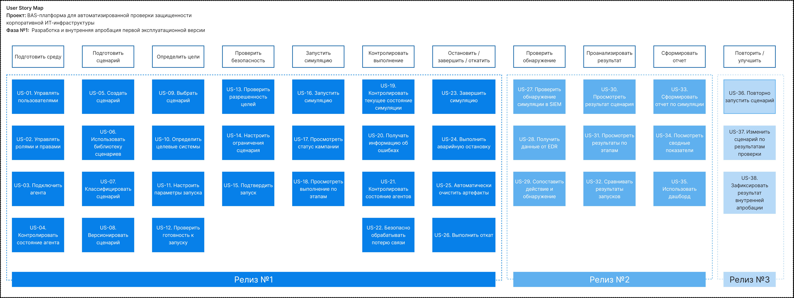

# User Story Map

[← Обзор проекта](../README.md) · [Исходный PDF](../sources/03-user-story-map.pdf)

> Учебный кейс «Школы 21», 2026. Фаза №1: разработка и внутренняя апробация. Документ описывает планируемую систему; реализация и приемочные испытания не выполнялись в рамках представленных материалов.

**BAS-платформа для безопасной симуляции кибератак**

**Фаза №1. Разработка и внутренняя апробация первой эксплуатационной версии**

## Содержание

- [Пользовательские роли](#section-01)
- [Основные этапы пользовательского пути](#section-02)
- [User Stories графическое представление](#section-03)
- [User Stories детальное представление](#section-04)
- [Фаза №1. Срезы](#section-05)
- [Релизы Фазы №1](#section-06)

## Пользовательские роли

**Основные роли, которые участвуют в пользовательских сценариях:**

| Роль | Кто это | Что делает в BAS |
| --- | --- | --- |
| Администратор платформы | Технический администратор BAS | Пользователи, роли, агенты, интеграции, настройки |
| Оператор симуляций | Специалист, который запускает кампании | Выбирает сценарий, цели, параметры, запускает и останавливает симуляцию |
| Аналитик ИБ | Специалист по анализу результатов | Смотрит события, обнаружение, результаты, сравнивает прогоны |
| Эксперт по сценариям | Специалист, отвечающий за содержимое сценариев | Создает, редактирует, проверяет сценарии и их маппинг |
| Руководитель ИБ | Руководитель / заказчик | Смотрит сводные результаты, отчетность, динамику |

**Права и ответственность каждого пользователя:**

| Действие | Админ | Оператор | Аналитик ИБ | Эксперт сценариев | Руководитель |
| --- | --- | --- | --- | --- | --- |
| Управлять пользователями | + | - | - | - | - |
| Подключать агентов | + | - | - | - | - |
| Создавать сценарий | - | - | - | + | - |
| Настраивать цели | - | + | - | + | - |
| Запускать симуляцию | - | + | - | - | - |
| Останавливать симуляцию | - | + | - | - | - |
| Смотреть результаты | + | + | + | + | + |
| Анализировать обнаружение | - | - | + | + | + |
| Смотреть сводную отчетность | - | - | + | + | + |
| Управлять ролями | + | - | - | - | - |

Основной пользовательский путь в USM строится вокруг оператора симуляций, поскольку его сценарий наиболее полно отражает работу платформы

## Основные этапы пользовательского пути

| № | Пользовательская активность |
| --- | --- |
| 1 | Подготовить среду |
| 2 | Подготовить сценарий |
| 3 | Определить цели симуляции |
| 4 | Проверить безопасность |
| 5 | Запустить симуляцию |
| 6 | Контролировать выполнение |
| 7 | Остановить / завершить / откатить |
| 8 | Проверить обнаружение |
| 9 | Проанализировать результат |
| 10 | Сформировать отчет |
| 11 | Повторить / улучшить сценарий |

## User Stories графическое представление

## User Stories детальное представление

### Подготовить среду

#### US-01. Управлять пользователями

Как администратор платформы, я хочу создавать и настраивать учетные записи пользователей, чтобы предоставлять доступ к платформе в соответствии с их ролями

Приоритет: критический

#### US-02. Управлять ролями и правами

Как администратор платформы, я хочу назначать пользователям роли и права доступа, чтобы ограничивать их действия в соответствии с полномочиями

Приоритет: критический

#### US-03. Подключить агента

Как администратор платформы, я хочу зарегистрировать агента на целевой системе, чтобы BAS-платформа могла выполнять разрешенные действия в рамках симуляции

Приоритет: критический

#### US-04. Контролировать состояние агента

Как администратор платформы, я хочу видеть состояние и доступность агентов, чтобы понимать, готова ли инфраструктура к запуску симуляции

Приоритет: критический

### Подготовить сценарий

#### US-05. Создать сценарий

Как эксперт по сценариям, я хочу создавать сценарии симуляции кибератак, чтобы воспроизводить выбранные модели поведения атакующего

Приоритет: критический

#### US-06. Использовать библиотеку сценариев

Как эксперт по сценариям, я хочу хранить и просматривать библиотеку сценариев, чтобы повторно использовать проверенные сценарии

Приоритет: критический

#### US-07. Классифицировать сценарий

Как эксперт по сценариям, я хочу связывать сценарий с соответствующим вектором атаки и MITRE ATT&CK, чтобы понимать, какие техники и направления атак он моделирует

Приоритет: критический

В Фазе №1 библиотека должна охватывать три заявленных направления: фишинг, сетевые атаки и внедрение ВПО; целевой минимум - шесть утвержденных сценариев, по два на каждое направление

#### US-08. Версионировать сценарий

Как эксперт по сценариям, я хочу сохранять версии сценария, чтобы иметь возможность контролировать изменения и возвращаться к проверенной версии

Приоритет: критический

### Определить цели симуляции

#### US-09. Выбрать сценарий

Как оператор симуляций, я хочу выбрать утвержденный сценарий, чтобы подготовить его к запуску

Приоритет: критический

#### US-10. Определить целевые системы

Как оператор симуляций, я хочу указать разрешенные цели симуляции, чтобы сценарий выполнялся только в предусмотренной области

Приоритет: критический

#### US-11. Настроить параметры запуска

Как оператор симуляций, я хочу задать необходимые параметры симуляции, чтобы запуск соответствовал конкретной проверке

Приоритет: критический

#### US-12. Проверить готовность к запуску

Как оператор симуляций, я хочу получить информацию о готовности сценария, агентов и целей чтобы не запускать симуляцию при неподготовленной среде

Приоритет: критический

### Проверить безопасность

#### US-13. Проверить разрешенность целей

Как оператор симуляций, я хочу перед запуском проверить, то выбранные цели разрешены для симуляции, чтобы исключить воздействие на запрещенные системы

Приоритет: критический

#### US-14. Настроить ограничения сценария

Как эксперт по сценариям, я хочу задавать ограничения на действия сценария, чтобы симуляция выполнялась в заранее определенных безопасных границах

Приоритет: критический

#### US-15. Подтвердить запуск

Как оператор симуляций, я хочу явно подтверждать запуск потенциально опасной операции, чтобы снизить риск случайного выполнения симуляции

Приоритет: критический

### Запустить симуляцию

#### US-16. Запустить симуляцию

Как оператор симуляций, я хочу запустить подготовленный сценарий, чтобы провести симуляцию атаки на выбранных целях

Приоритет: критический

#### US-17. Просмотреть статус кампании

Как оператор симуляций, я хочу видеть статус запуска и выполнения сценария, чтобы понимать, что происходит с симуляцией

Приоритет: критический

#### US-18. Просмотреть выполнение по этапам

Как оператор симуляций, я хочу видеть выполнение сценария по отдельным этапам, чтобы контролировать прогресс и результаты отдельных действий

Приоритет: критический

### Контролировать выполнение

#### US-19. Контролировать текущее состояние симуляции

Как оператор симуляций, я хочу видеть, все ли безопасно в процессе выполнения: состояние компонентов, предупреждения, потеря связи, переход в безопасное состояние

Приоритет: критический

#### US-20. Получать информацию об ошибках

Как оператор симуляций, я хочу получать информацию об ошибках выполнения, чтобы понимать причину проблем и принимать решение о продолжении или остановке

Приоритет: критический

#### US-21. Контролировать состояние агентов

Как оператор симуляций, я хочу видеть состояние агентов во время выполнения, чтобы понимать, может ли симуляция продолжаться безопасно

Приоритет: критический

#### US-22. Безопасно обрабатывать потерю связи

Как оператор симуляций, я хочу чтобы платформа безопасно реагировала на потерю связи с серером или агентом, чтобы снижение доступности компонентов не приводило к неконтролируемому выполнению действий

Приоритет: критический

### Остановить / завершить / откатить

#### US-23. Завершить симуляцию

Как оператор симуляций, я хочу корректно завершить симуляцию, чтобы остановить выполнение после достижения цели проверки

Приоритет: критический

#### US-24. Выполнить аварийную остановку

Как оператор симуляций, я хочу выполнить экстренную остановку симуляции, чтобы немедленно прекратить дальнейшие действия при возникновении угрозы

Приоритет: критический

#### US-25. Автоматически очистить артефакты

Как оператор симуляций, я хочу завершать симуляцию с автоматической очисткой созданных в процессе симуляции артефакты, чтобы после теста не оставались нежелательные следы или изменения

Приоритет: критический

#### US-26. Выполнить откат

Как оператор симуляций, я хочу выполнить безопасный откат результатов сценария, чтобы вернуть тестовую среду в предусмотренное состояние Приоритет: критический

### Проверить обнаружение

#### US-27. Проверить обнаружение симуляции в SIEM

Как аналитик ИБ, я хочу проверить обнаружение симуляции в SIEM, чтобы проверять, как средства мониторинга обнаруживают моделируемую активность

Приоритет: критический

#### US-28. Получить данные от EDR

Как аналитик ИБ, я хочу использовать данные EDR при анализе симуляции, чтобы оценивать реакцию средств защиты конечных точек

Приоритет: критический

#### US-29. Сопоставить действие и обнаружение

Как аналитик ИБ, я хочу сопоставлять выполненные действия сценария с событиями, зарегестрированными средствами защиты, чтобы оценивать эффективность обнаружения

Приоритет: критический

### Проанализировать результат

#### US-30. Просмотреть результат сценария

Как аналитик ИБ, я хочу увидеть итог выполнения сценария, чтобы определить, какие действия были успешно выполнены, а какие нет

Приоритет: критический

#### US-31. Просмотреть результаты по этапам

Как аналитик ИБ, я хочу анализировать результат каждого этапа сценария. чтобы находить конкретные точки, на которых средства защиты обнаружили или заблокировали активность

Приоритет: критический

#### US-32. Сравнивать результаты запусков

Как аналитик ИБ, я хочу сравнивать результаты разных запусков одного сценария, чтобы отслеживать изменения эффективности средств защиты

Приоритет: высокий

### Сформировать отчет

#### US-33. Сформировать отчет по симуляции

Как аналитик ИБ, я хочу формировать отчет по результатам симуляции, чтобы зафиксировать результаты проведенной проверки

Приоритет: критический

#### US-34. Посмотреть сводные показатели

Как руководитель ИБ, я хочу видеть сводные показатели результатов симуляций, чтобы оценивать эффективность проведенных проверок

Приоритет: критический

#### US-35. Использовать дашборд

Как аналитик ИБ, я хочу видеть результаты симуляций на дашборде, чтобы быстро оценивать состояние и результаты проверок

Приоритет: критический

### Повторить / улучшить сценарий

#### US-36. Повторно запустить сценарий

Как эксперт по сценариям, я хочу повторно запустить сценарий с теми же или измененными параметрами, чтобы проверить воспроизводимость результата

Приоритет: критический

#### US-37. Изменить сценарий по результатам проверки

Как эксперт по сценариям, я хочу изменить сценарий по результатам внутренней апробации, чтобы улучшать покрытие и качество проверки

Приоритет: высокий

#### US-38. Зафиксировать результат внутренней апробации

Как эксперт по сценариям, я хочу зафиксировать результаты внутренней апробации, чтобы сформировать основание для принятия решения о дальнейшем развитии продукта

Приоритет: критический

## Фаза №1. Срезы

### Срез №1

**Пользователь должен иметь возможность:**

- Подготовить среду

- Выбрать сценарий

- Определить цель

- Проверить безопасность

- Запустить

- Контролировать

- Безопасно завершить

- Получить результат

- Проверить обнаружение

### Срез №2

**Пользователь должен иметь возможность:**

- Использовать результаты выполненной симуляции

- Проанализировать результат

- Сопоставить действия с обнаружениями

- Сформировать отчет

### Срез №3

**Пользователь должен иметь возможность:**

- Повторно запустить сценарий

- Получить сопоставимый результат

- Сравнить результаты

- Зафиксировать выводы

## Релизы Фазы №1

### Релиз №1. Базовая платформа

**Включает:**

- Пользователей и роли

- Управление агентами

- Библиотеку сценариев

- Создание/версионирование сценариев

- Выбор целей

- Базовый запуск

- Мониторинг выполнения

- Остановку

- Очистку и откат

### Релиз №2. Эксплуатационная версия

**Добавляются:**

- Оркестрация

- SIEM

- EDR

- Дашборд

- Отчетность

- Расширенный контроль выполнения

- Обработка ошибок и потери связи

### Релиз №3. Внутренняя апробация

**Включает:**

- Не менее 6 утвержденных сценариев

- 3 заявленных векторов атак

- Повторные запуски

- Проверку обнаружения средствами защиты

- Проверку отката

- Фиксацию результатов

- Устранение выявленных проблем

- Итоговый отчет внутренней апробации
