# Концептуальное техническое задание

[← Обзор проекта](../README.md) · [Исходный PDF](../sources/06-technical-specification.pdf)

> Учебный кейс «Школы 21», 2026. Фаза №1: разработка и внутренняя апробация. Документ описывает планируемую систему; реализация и приемочные испытания не выполнялись в рамках представленных материалов.

**Система:** BAS Platform. **Версия исходного ТЗ:** 0.1. **Дата:** 17.09.2026.

> Иллюстрации интерфейса — референсы существующего продукта из исходного ТЗ.

## Содержание

- [Общие сведения](#section-01)
- [Цели и назначение создания автоматизированной системы](#section-02)
- [Характеристика объекта автоматизации](#section-03)
- [Требования к автоматизированной системе](#section-04)
- [Требования к функциям, выполняемым системой](#section-05)
- [Требования к интеграции с внешними системами](#section-06)
- [Требования к видам обеспечения автоматизированной системы](#section-07)
- [Общие технические требования](#section-08)
- [Требования к пользовательскому интерфейсу](#section-09)
- [Требования к мониторингу, аналитике и отчетности](#section-10)
- [Требования к тестированию и качеству](#section-11)
- [Состав и содержание работ по созданию системы](#section-12)
- [Порядок разработки автоматизированной системы](#section-13)
- [Порядок контроля и приемки автоматизированной системы](#section-14)
- [Требования к подготовке объекта автоматизации к вводу системы в действие](#section-15)
- [Требования к документированию](#section-16)
- [Источники разработки](#section-17)
- [Ограничения первой версии](#section-18)
- [Результат создания системы](#section-19)

## Общие сведения

### Полное наименование автоматизированной системы

Автоматизированная система "BAS-платформа для автоматизированной проверки защищенности корпоративной ИТ-инфраструктуры путем безопасной симуляции сценариев кибератак и оценки эффективности средств защиты"

Условное обозначение системы: BAS Platform / BAS

### Назначение документа

Настоящее техническое задание определяет основные требования к созданию первой эксплуатационной версии BAS-платформы и ее внутренней апробации в рамках Фазы №1 проекта

В исходной работе структура документа ориентирована на ГОСТ 34.602–2020. В этом учебном кейсе не заявляется проверенное соответствие стандарту; нормативная экспертиза не проводилась.

### Заказчик и разработчик

Заказчик: внутренняя ИБ-функция корпорации в лице Директора по информационной безопасности

Спонсор проекта: представитель руководства корпорации

Разработчик: выделенная проектная команда, включающая Product Owner, PM, технического лидера, backend- и frontend- разработчиков, QA, DevSecOps и экспертов ИБ

Конкретная организационная структура разработчика определяется корпоративной моделью управления проектами

### Основания для создания системы

Основаниями для разработки являются:

- Устав проекта «BAS-платформа для автоматизированной проверки защищенности корпоративной ИТ-инфраструктуры»

- Карта требований проекта, версия 0.1

- User Story Map проекта

- Реестр требований проекта, версия 0.1

- Решение о запуске Фазы №1 проекта

- Настоящий документ

### Плановые сроки

Дата начала работ: 17.09.2026

Дата окончания работ: 17.09.2027

Продолжительность Фазы №1: 12 месяцев

## Цели и назначение создания автоматизированной системы

### Цели создания системы

Основной целью создания BAS-платформы является автоматизация контролируемой проверки защищенности корпоративной ИТ-инфраструктуры посредством воспроизводимого выполнения безопасных сценариев кибератак и последующей оценки реакции существующих средств защиты

В рамках Фазы №1 должны быть достигнуты следующие результаты:

1. Создана первая эксплуатационная версия BAS-платформы.

2. Обеспечен запуск не менее 6 утвержденных сценариев по трем направлениям:

- Фишинг

- Сетевые атаки

- Имитация распространения вредоносного ПО

3. Обеспечена интеграция минимум с одной корпоративной SIEM и одной EDR

4. Для 100% утвержденных сценариев реализован и протестирован механизм безопасной очистки и отката

5. Обеспечен контролируемый запуск сценариев только в разрешенной области

6. Проведена внутренняя апробация на stage-среде и в заранее согласованных контролируемых сегментах корпоративной инфраструктуры

7. Получены результаты проверки обнаружения и предотвращения моделируемой активности средствами защиты

8. Подтверждена воспроизводимость утвержденных сценариев

9. Подготовлены техническая и пользовательская документация

10. Сформирована основа для принятия решения о переходе к Фазе №2

### Назначение системы

BAS-платформа предназначена для внутренних подразделений информационной безопасности и ИТ и обеспечивает:

- Подготовку и управление сценариями симуляции

- Управление агентами

- Формирование и запуск кампаний

- Контроль безопасных условий выполнения

- Мониторинг выполнения сценариев

- Экстренную остановку симуляций

- Автоматическую очистку и откат

- Получение телеметрии из SIEM и EDR

- Сопоставление действий сценария с событиями средств защиты

- Анализ результатов

- Формирование отчетности

- Повторное выполнение утвержденных сценариев

BAS-платформа не является средством эксплуатации внешних клиентских сред в рамках Фазы №1 и не включает функции коммерческой эксплуатации, биллинга и мультиарендности

## Характеристика объекта автоматизации

### Объект автоматизации

Объектом автоматизации является процесс внутренней проверки эффективности средств защиты корпоративной ИТ-инфраструктуры посредством контролируемой симуляции действий атакующего

В объект автоматизации входят:

- Корпоративная ИТ-инфраструктура

- Конечные рабочие станции и серверные системы

- Контролируемые сетевые сегменты

- Существующие средства защиты

- SIEM

- EDR

- Специалисты ИБ и ИТ, участвующие в подготовке и проведении проверок

### Условия эксплуатации

Платформа эксплуатируется внутри корпоративного контура

Разработка, тестирование, хранение кода, сценариев и артефактов выполняются внутри периметра корпорации

Внешние публичные облачные провайдеры в рамках Фазы №1 не используются

Предварительное тестирование сценариев осуществляется на изолированных stage-стендах. Внутренняя апробация выполняется только на stage-среде и в заранее согласованных контролируемых сегментах

### Пользователи системы

В системе предусматриваются следующие роли:

| Роль | Основные функции |
| --- | --- |
| Администратор платформы | Пользователи, роли, агенты, конфигурация |
| Оператор симуляций | Подготовка и запуск кампаний, контроль выполнения, остановка |
| Аналитик ИБ | Анализ результатов и данных средств защиты |
| Эксперт по сценариям | Создание, изменение, валидация и маппинг сценариев |
| Руководитель ИБ | Просмотр сводных результатов и отчетности |

## Требования к автоматизированной системе

### Требования к структуре системы

BAS-платформа должна иметь распределенную архитектуру и включать следующие основные компоненты:

1. Сервер управления

- Управление пользователями и ролями

- Хранение конфигурации

- Хранение сценариев

- Управление кампаниями

- Координация агентов

- Получение и обработка результатов

2. Модуль оркестрации

- Формирование кампаний

- Запуск сценариев

- Запуск по расписанию

- Контроль последовательности действий

- Управление параллельными запусками

3. Агенты

- Выполнение разрешенных действий сценариев

- Передача статуса и результатов

- Получение команд управления

- Выполнение процедур безопасного завершения и очистки

4. Прокси-ноды

- Обеспечение связности между компонентами в изолированных сетевых сегментах

- Передача служебного трафика по разрешенным направлениям

5. Репозиторий сценариев

- Централизованное хранение сценариев

- Версионирование

- Хранение метаданных

- Хранение правил безопасного выполнения

6. Модуль интеграции с СЗИ

- Получение телеметрии

- Сопоставление событий

- Определение результатов обнаружения и предотвращения

7. Модуль мониторинга и аналитики

- Состояние платформы

- Состояние агентов

- Состояние кампаний

- Результаты симуляций

- Данные SIEM/EDR

8. Web-интерфейс

- Управление платформой

- Создание и запуск кампаний

- Управление сценариями

- Просмотр результатов

- Формирование отчетов

Архитектура должна обеспечивать возможность расширения набора сценариев и добавления новых интеграций без изменения базового принципа работы системы

Возможность реализации мультиарендности в следующих фазах должна учитываться при проектировании архитектуры, но функциональность мультиарендности в Фазе №1 не реализуется

## Требования к функциям, выполняемым системой

### Управление пользователями и доступом

Система должна обеспечивать:

- Создание и блокировку учетных записей

- Назначение ролей

- Разграничение полномочий

- Аутентификацию пользователей

- Двухфакторную аутентификацию

- Контроль доступа к функциям и данным

- Регистрацию действий пользователей в журнале аудита

В Фазе №1 принимается использование Keycloak в качестве провайдера идентификации с интеграцией с корпоративным LDAP/Active Directory

В качестве второго фактора принимается TOTP

Права каждой роли должны быть разграничены по принципу минимально необходимых полномочий

**Пример реализации в существующем продукте**

Аутентификация на платформе

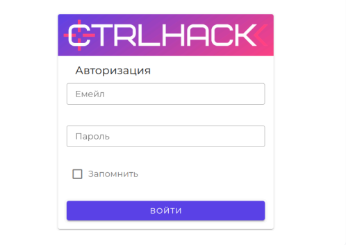

### Управление агентами

Система должна обеспечивать:

- Регистрацию агента

- Идентификацию агента

- Взаимную аутентификацию

- Отображение состояния

- Контроль доступности

- Обновление версии

- Отключение

- Безопасное удаление

- Контроль потребления ресурсов

Агенты должны функционировать в средах Windows и Linux

Агент должен работать с минимально необходимыми правами операционной системы

Целевой масштаб Фазы №1 до 100 одновременно зарегистрированных агентов

**Пример реализации в существующем продукте**

Создание агента

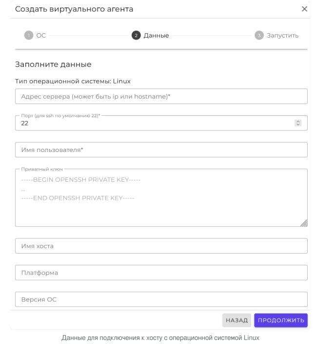

Информация об агенте

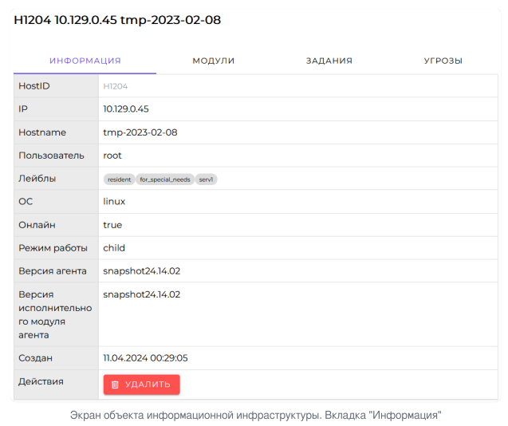

Удаление агента

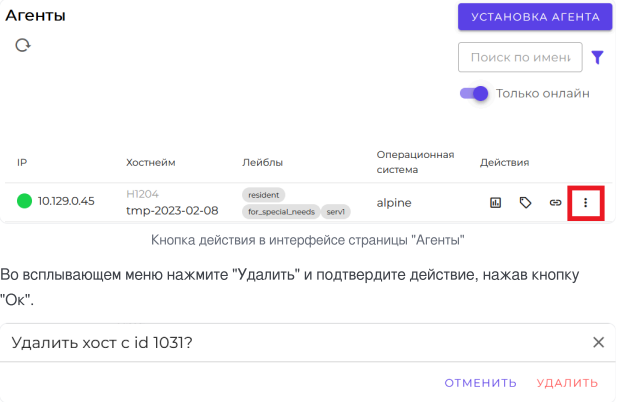

### Управление сценариями

Система должна обеспечивать:

- Создание сценария

- Редактирование

- Хранение

- Версионирование

- Классификацию

- Маппинг на MITRE ATT&CK

- Указание ожидаемого результата

- Задание параметров запуска

- Указание требований к целевой среде

- Определение ограничений

- Указание правил безопасного завершения

- Предварительное тестирование

- Утверждение сценария

- Откат к предыдущей версии

В первой эксплуатационной версии должно быть доступно не менее шести утвержденных сценариев:

| Направление | Минимальное количество |
| --- | --- |
| Фишинг | 2 |
| Сетевые атаки | 2 |
| Имитация распространения вредоносного ПО | 2 |
| Всего | 6 |

Конкретный состав сценариев и перечень покрываемых техник MITRE ATT&CK фиксируются отдельным реестром сценариев после согласования с Экспертом по ИБ и Директором по ИБ

**Пример реализации в существующем продукте**

Создание сценария

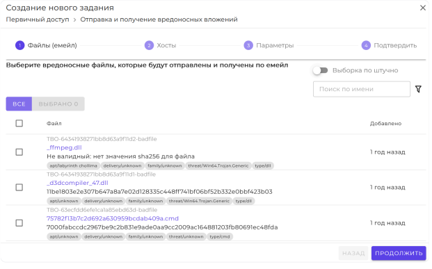

Задание параметров запуска/ограничений

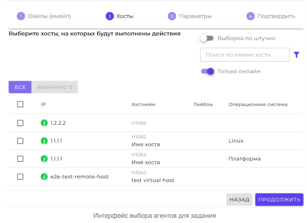

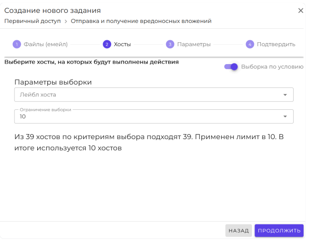

### Формирование кампании

Оператор должен иметь возможность:

- Выбрать утвержденный сценарий

- Выбрать целевые системы

- Выбрать агентов

- Задать параметры запуска

- Определить время запуска

- Сформировать кампанию

Каждой кампании должен автоматически присваиваться уникальный идентификатор

**Пример реализации в существующем продукте**

Выбор сценария/параметры запуска

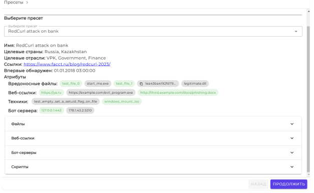

### Проверки перед запуском

Перед выполнением симуляции система должна автоматически проверять:

- Наличие цели в белом списке

- Отсутствие цели в черном списке

- Допустимость сценария

- Доступность агентов

- Наличие необходимых компонентов

- Лимит параллельных запусков

- Ограничение времени выполнения

- Наличие разрешения оператора

- Соответствие сценария утвержденным условиям проведения

Запуск на запрещенной цели должен быть технически невозможен

**Пример реализации в существующем продукте**

Доступность/допустимость сценария

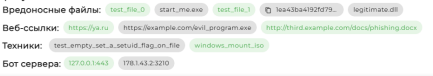

### Запуск и оркестрация

Система должна поддерживать:

- Ручной запуск

- Запуск в реальном времени

- Запуск по расписанию

- Последовательное выполнение этапов сценария

- Контроль состояния каждого этапа

- Ограничение числа параллельных кампаний

В рамках Фазы №1 принимается ограничение до 5 одновременно выполняемых кампаний

### Мониторинг выполнения

Оператор должен видеть:

- Текущий статус кампании

- Состояние сценария

- Состояние каждого этапа

- Состояние агентов

- Ошибки

- Предупреждения

- Потерю связи

- Переход в безопасное состояние

- Результат завершения

Основные операции интерфейса должны выполняться не более чем за 3 секунды для 95% стандартных запросов при штатной нагрузке Фазы №1

**Пример реализации в существующем продукте**

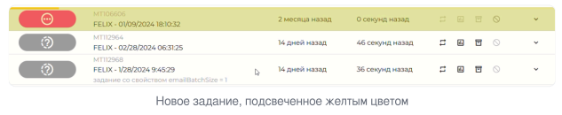

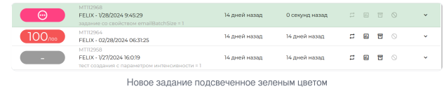

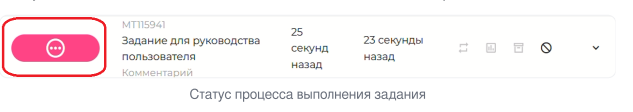

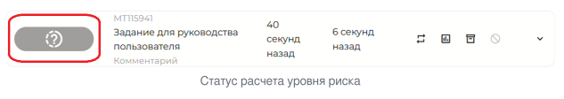

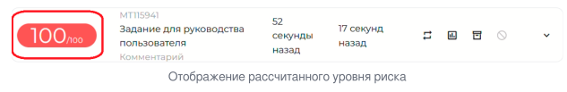

### Безопасная остановка

Система должна обеспечивать штатную остановку кампании оператором

Система должна обеспечивать механизм kill switch

Оператор имеет право остановить активную кампанию

Администратор платформы имеет право выполнить глобальную аварийную остановку активных кампаний

После активации kill switch:

- Новые действия сценариев не запускаются

- Активные действия прекращаются

- Агенты переводятся в безопасное состояние

- Фиксируется событие аварийной остановки

- Дальнейшие запуски блокируются до выполнения установленной процедуры проверки

Начало остановки должно быть инициировано не позднее 30 секунд после подтверждения команды kill switch

### Безопасное завершение и откат

Каждый сценарий должен иметь определенные процедуры завершения и очистки.

Автоматическая очистка должна обеспечивать удаление предусмотренных сценарием артефактов, в том числе:

- Созданных файлов

- Служб

- Записей конфигурации

- Тестовых учетных записей

- Других артефактов, создаваемых сценарием

Для 100% сценариев первой эксплуатационной версии должен существовать и быть протестирован механизм отката

Результат восстановления после отката должен подтверждаться контрольными проверками

### Обработка сбоев и потери связи

При недоступности Сервера управления новые сценарии не должны запускаться

При потере связи с агентом активная кампания должна перейти в заранее определенное безопасное состояние

При критическом сбое компонента система должна блокировать дальнейшие опасные операции

Инцидент, связанный с платформой или симуляцией, должен блокировать последующие симуляции до завершения расследования и получения разрешения на возобновление работ

## Требования к интеграции с внешними системами

### SIEM

В рамках Фазы №1 BAS должна интегрироваться минимум с одной корпоративной SIEM

В качестве целевой SIEM для версии 0.1 принимается MaxPatrol SIEM

Интеграция должна обеспечивать:

- Получение необходимых событий

- Привязку событий ко времени выполнения сценария

- Сопоставление событий с идентификатором кампании

- Определение факта обнаружения

- Передачу результата в BAS

Интеграция не должна изменять или удалять исходные события в SIEM

### EDR

В рамках Фазы №1 BAS должна интегрироваться минимум с одной корпоративной EDR

В качестве целевой EDR для версии 0.1 принимается MaxPatrol EDR

Интеграция должна обеспечивать:

- Получение необходимой телеметрии

- Сопоставление телеметрии с действиями сценария

- Определение факта обнаружения

- Определение факта предотвращения

- Передачу результата в BAS

### Общая модель результатов

Для каждого сценария система должна фиксировать:

- Обнаружен / не обнаружен

- Заблокирован / не заблокирован

- Результат не определен вследствие отсутствия или недостаточности телеметрии

Обнаружение считается подтвержденным при наличии события SIEM/EDR, сопоставленного с идентификатором кампании и временным интервалом соответствующего действия сценария

Блокировка считается подтвержденной при наличии данных EDR или другого согласованного источника, однозначно свидетельствующих о предотвращении действия

Отсутствие события само по себе не должно интерпретироваться как подтверждение блокировки

## Требования к видам обеспечения автоматизированной системы

### Информационное обеспечение

Система должна хранить и обрабатывать:

- Учетные записи пользователей

- Роли и права

- Сведения об агентах

- Конфигурацию

- Сценарии

- Версии сценариев

- Кампании

- Результаты выполнения

- Телеметрию

- События SIEM/EDR

- Журнал аудита

- Отчеты

- Служебные данные

Сценарий должен содержать как минимум:

- Уникальный идентификатор

- Описание

- Направление атаки

- MITRE ATT&CK маппинг

- Версию

- Ожидаемый результат

- Параметры запуска

- Требования к целевой среде

- Правила безопасного завершения

### Хранение и восстановление данных

Результаты симуляций должны храниться не менее 180 дней

Журнал аудита должен храниться не менее 365 дней, если внутренними нормативными документами корпорации не предусмотрен более длительный срок

Критичные данные должны резервироваться не реже одного раза в сутки

Целевые показатели:

- RPO не более 24 часов

- RTO не более 4 часов

Резервное копирование и восстановление должны быть проверены в рамках приемочных испытаний

### Программное обеспечение

Для реализации системы принимается следующий базовый технологический стек:

| Компонент | Технология |
| --- | --- |
| Backend | Go |
| Агент | Go |
| Frontend | React + TypeScript |
| API | REST |
| Внутреннее взаимодействие компонентов | gRPC |
| Защищенное взаимодействие | mTLS |
| СУБД | PostgreSQL |
| Очередь сообщений | RabbitMQ |
| Хранилище артефактов | MinIO |
| Identity Provider | Keycloak |
| MFA | TOTP |
| CI/CD | GitLab CI |
| Контейнеризация | Docker |
| Управление конфигурацией | Ansible |
| Мониторинг | Prometheus + Grafana |
| SIEM | MaxPatrol SIEM |
| EDR | MaxPatrol EDR |

Выбор технологического стека является базовым решением версии 0.1 и может быть изменен по итогам архитектурного проектирования при условии сохранения утвержденных требований к системе

### Техническое обеспечение

Развертывание осуществляется на инфраструктуре корпорации

Для Фазы №1 предусматриваются:

- Серверы компонентов BAS

- Серверы/узлы хранения

- Stage-инфраструктура

- Тестовые конечные станции

- Агенты

- Прокси-ноды при необходимости

- Сетевые средства подключения компонентов

- Инфраструктура резервного копирования

### Лингвистическое обеспечение

Пользовательский интерфейс первой версии разрабатывается на русском языке

Описание сценариев, параметров и маппинга MITRE ATT&CK должно поддерживать терминологию, используемую корпоративными подразделениями ИБ

### Организационное обеспечение

Эксплуатация системы осуществляется сотрудниками ИБ и ИТ в соответствии с утвержденными регламентами

До допуска сценария к внутренней апробации должны быть выполнены:

1. Разработка сценария

2. Тестирование на stage

3. Проверка безопасности

4. Проверка отката

5. Утверждение сценария

### Методическое обеспечение

Проведение симуляций осуществляется в соответствии с корпоративным документом "Регламент безопасного проведения проверок защищенности" и утвержденными Правилами взаимодействия

В регламенте должны быть определены:

- Допустимые цели

- Запрещенные цели

- Опустимые сценарии

- Запрещенные действия

- Порядок согласования

- Порядок запуска

- Порядок остановки

- Порядок реагирования на инцидент

- Порядок проведения отката

- Порядок допуска сценариев в контролируемый контур

## Общие технические требования

### Производительность

Агент при штатном выполнении сценария:

- CPU — не более 5% в пике

- RAM — не более 100 МБ в пике

Показатели проверяются на утвержденной эталонной конфигурации тестового стенда

Система должна поддерживать:

- До 100 одновременно зарегистрированных агентов

- До 5 одновременно выполняемых кампаний

Целевое время получения и первичной корреляции телеметрии — не более 60 секунд

### Надежность

Система должна:

- Предотвращать запуск новых сценариев при недоступности Сервера управления

- Переводить активные кампании в безопасное состояние при критической потере связи

- Обеспечивать восстановление после сбоя

- Вести журнал критических событий

- Обеспечивать резервное копирование критичных данных

### Безопасность

В системе должны быть реализованы:

- RBAC

- MFA

- Принцип минимальных привилегий

- Защищенное взаимодействие компонентов

- mTLS

- Корпоративная PKI

- Цифрование хранилищ сценариев и артефактов

- Аудит действий

- Защита журналов аудита от некорректируемого изменения

- Белый список целей

- Черный список критических сегментов

- Лимит параллельных запусков

- Ограничение времени выполнения

- Kill switch

- Обязательное подтверждение оператора

- Запрет потенциально разрушительных действий

Сценарии моделируемой активности не должны автоматически исключаться из контроля корпоративных средств защиты

### Требования к агенту

Агент должен:

- Работать с минимальными правами

- Проходить аутентификацию

- Иметь уникальный идентификатор

- Поддерживать безопасное обновление

- Поддерживать самоочистку

- Ограничивать потребление CPU/RAM

- Корректно обрабатывать потерю связи

- Не продолжать выполнение новых действий при недоступности управляющего компонента

### Масштабируемость

Архитектура должна предусматривать:

- Расширение библиотеки сценариев

- Добавление новых интеграций

- Увеличение числа агентов

- Расширение аналитической функциональности

- Дальнейшую реализацию мультиарендности без необходимости полного перепроектирования системы

## Требования к пользовательскому интерфейсу

Web-интерфейс должен предоставлять пользователю следующие основные разделы:

1. Пользователи и роли

2. Агенты

3. Сценарии

4. Кампании

5. Мониторинг

6. Результаты

7. Дашборд

8. Отчеты

9. Аудит

10. Настройки

Для оператора должен быть доступен последовательный пользовательский путь:

1. Выбор сценария

2. Выбор целей

3. Проверка безопасности

4. Настройка параметров

5. Подтверждение

6. Запуск

7. Контроль

8. Завершение/остановка

9. Откат

10. Получение результата

## Требования к мониторингу, аналитике и отчетности

### Мониторинг

Дашборд должен отображать:

- Состояние Сервера управления

- Состояние агентов

- Активные кампании

- Статусы сценариев

- Ошибки

- Критические события

- Результаты обнаружения

- Результаты блокировки

- Состояние интеграций

**Пример реализации в существующем продукте**

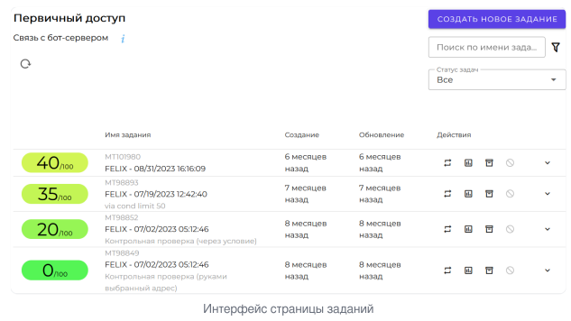

### Аналитика

Система должна обеспечивать:

- Просмотр результатов сценария

- Просмотр результатов по отдельным этапам

- Сопоставление действий с событиями средств защиты

- Анализ обнаружения

- Анализ предотвращения

- Сравнение повторных запусков

- Визуализацию покрытия сценариями

- Получение сводных показателей

**Пример реализации в существующем продукте**

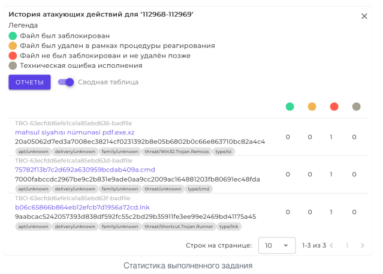

### Отчетность

Система должна обеспечивать формирование отчета по результатам кампании.

Отчет должен содержать как минимум:

- Идентификатор кампании

- Сценарий

- Цели

- Время проведения

- Результаты выполнения

- Результаты обнаружения

- Результаты блокировки

- Сведения о телеметрии

- Сведения об ошибках

- Результат отката

- Выявленные ограничения

- Выводы

Форматы экспорта и дополнительные требования к отчетам уточняются в рамках детального проектирования

**Пример реализации в существующем продукте**

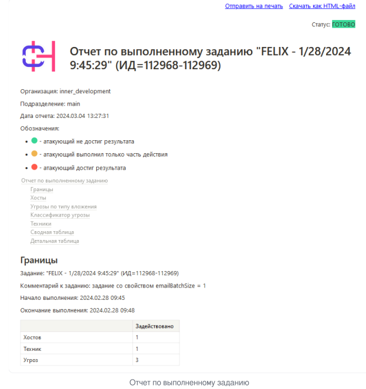

## Требования к тестированию и качеству

### Виды испытаний

Для системы предусматриваются:

- Unit-тестирование

- Функциональное тестирование

- Интеграционное тестирование

- Нагрузочное тестирование

- Тестирование безопасности

- Тестирование агентов

- Тестирование сценариев

- Тестирование отката

- Регрессионное тестирование

- Приемочные испытания

### Stage-среда

Каждый сценарий до допуска к контролируемой внутренней апробации должен пройти:

1. Тестирование на изолированном stage-стенде

2. Проверку безопасности

3. Проверку выполнения

4. Проверку очистки

5. Проверку отката

6. Утверждение

### Критерии качества

На момент передачи первой эксплуатационной версии:

- Отсутствуют критические и блокирующие дефекты в ядре

- Откат протестирован для 100% сценариев

- Подтверждена воспроизводимость утвержденных сценариев

- CPU- и RAM-показатели соответствуют установленным ограничениям

- Результаты интеграции с SIEM и EDR подтверждены

- Подготовлена необходимая документация

## Состав и содержание работ по созданию системы

Создание системы выполняется по следующим основным этапам

| № | Этап | Содержание | Срок |
| --- | --- | --- | --- |
| 1 | Детализация требований и проектирование | Требования, USM, архитектура, stage, ТЗ | 17.09.2026-17.11.2026 |
| 2 | Разработка ядра и агентов | Сервер управления, база сценариев, агенты, откат | 18.11.2026-17.02.2027 |
| 3 | Оркестрация и интеграции | Оркестрация, SIEM, EDR, корреляция, отчетность | 18.02.2027-17.05.2027 |
| 4 | UI и эксплуатационная версия | Интерфейс, интеграция компонентов, пробный запуск компонентов | 18.05.2027-17.07.2027 |
| 5 | Внутренняя апробация | Проведение сценариев, оценка результатов, исправления | 18.07.2027-31.08.2027 |
| 6 | Приемка и завершение | Документация, итоговый отчет, приемка | 01.09.2027-17.09.2027 |

## Порядок разработки автоматизированной системы

Разработка ведется итерационно

На этапе проектирования должны быть окончательно определены:

- Архитектура системы

- Состав компонентов

- Интерфейсы взаимодействия

- Модели данных

- Перечень интеграционных интерфейсов

- Конкретный состав сценариев

- Технические параметры, оставшиеся открытыми в версии 0.1

- Методика испытаний

Разработка и тестирование выполняются внутри корпоративного контура

Исходный код и результаты сборки размещаются в корпоративной системе управления исходным кодом

Для CI/CD используется GitLab CI

В процессе разработки применяются:

- Код ревью

- Автоматические проверки

- Сканирование зависимостей

- Тестирование безопасности

- Автоматизированное тестирование

- Регрессионное тестирование

Изменения, влияющие на границы проекта, ключевые сроки, бюджет, безопасность или архитектуру, проходят установленную процедуру управления изменениями

## Порядок контроля и приемки автоматизированной системы

### Виды контроля

Приемка включает:

1. Контроль функционального соответствия

2. Контроль безопасности

3. Проверку интеграций

4. Нагрузочные проверки

5. Проверку отката

6. Проверку отказоустойчивости

7. Внутреннюю апробацию

8. Проверку документации

### Основные критерии приемки

Первая эксплуатационная версия считается соответствующей ТЗ при выполнении следующих условий:

1. Система развернута в согласованном корпоративном контуре

2. Настроена ролевая модель

3. Зарегистрированы и функционируют агенты

4. Доступны минимум 6 утвержденных сценариев

5. Сценарии покрывают три целевых направления

6. Каждый сценарий имеет MITRE ATT&CK маппинг

7. Реализован запуск

8. Реализован мониторинг выполнения

9. Реализована штатная и аварийная остановка

10. Реализована очистка и откат

11. Работает SIEM-интеграция

12. Работает EDR-интеграция

13. Обеспечено сопоставление действий с телеметрией

14. Работает дашборд

15. Формируются отчеты

16. Реализованы белый и черный списки

17. Действует ограничение параллельных запусков

18. Действует ограничение времени выполнения

19. Работает kill switch

20. Действует обязательное подтверждение оператора

21. Реализована безопасная обработка потери связи

22. Ведется аудит

23. Взаимодействие компонентов защищено

24. Агенты работают с ограниченными правами

25. Откат протестирован для 100% сценариев

26. В ходе апробации не произошло критических инцидентов по вине платформы

27. Не произошло недоступности критических корпоративных сервисов вследствие выполнения BAS-сценариев

28. Отсутствуют критические и блокирующие дефекты в ядре

29. Соблюдены показатели CPU/RAM

30. Подготовлена техническая и пользовательская документация

### Приемочная комиссия

Результаты внутренней апробации и функциональное соответствие системы принимает Внутренний заказчик Директор по ИБ

Решение о завершении Фазы №1 и переходе к следующей фазе принимает Спонсор проекта на основании результатов апробации и итогового отчета

## Требования к подготовке объекта автоматизации к вводу системы в действие

До ввода BAS-платформы в эксплуатацию должны быть выполнены следующие мероприятия:

- Подготовлены серверные мощности

- Развернута stage-среда

- Подготовлены контролируемые сегменты

- Определены разрешенные и запрещенные цели

- Предоставлены необходимые учетные записи

- Настроены SIEM и EDR-интеграции

- Настроены роли и доступы

- Подготовлены и утверждены сценарии

- Утвержден регламент безопасного проведения проверок

- Проведено тестирование сценариев

- Подготовлена эксплуатационная документация

- Проведен инструктаж пользователей

- Назначены ответственные за сопровождение

- Назначены ответственные за обработку инцидентов

- Назначены ответственные за обновление сценариев

## Требования к документированию

В рамках Фазы №1 должны быть подготовлены:

**Техническая документация**

- Описание архитектуры

- Описание компонентов

- Описание моделей данных

- Описание интерфейсов

- Описание интеграций

- Описание развертывания

- Описание конфигурации

- Описание управления агентами

- Описание управления сценариями

- Описание процедур обновления

- Описание отката

- Описание резервного копирования и восстановления

- Описание мониторинга

**Пользовательская документация**

- Руководство администратора

- Руководство оператора

- Руководство аналитика

- Инструкция по работе со сценариями

- Инструкция по формированию кампаний

- Инструкция по просмотру результатов

- Инструкция по работе с отчетами

- Инструкция по действиям при инциденте

**Итоговые документы Фазы №1**

- Протоколы испытаний

- Результаты внутренней апробации

- Итоговый отчет

- Перечень выявленных ограничений

- Перечень выявленных недостатков защитных мер

- Актуализированный бэклог дальнейшего развития

- Рекомендации по переходу к Фазе №2

## Источники разработки

При разработке и дальнейшем уточнении настоящего ТЗ используются:

1. Устав проекта "BAS-платформа для автоматизированной проверки защищенности корпоративной ИТ-инфраструктуры"

2. Карта требований проекта, версия 0.1

3. User Story Map проекта

4. Реестр требований проекта

5. Корпоративный "Регламент безопасного проведения проверок защищенности" — предполагаемый документ учебной организации, не приложен

6. Внутренние нормативные документы корпорации в области информационной безопасности — предполагаемые документы, не приложены

7. Документация и технические спецификации выбранных корпоративных средств защиты — планируемые источники детализации; подтвержденные спецификации в архиве отсутствуют

8. ГОСТ 34.602–2020 — ориентир структуры, указанный автором исходного ТЗ.

## Ограничения первой версии

В Фазу №1 не входят:

- Внешние B2B-пилоты

- Адаптация платформы под инфраструктуру внешних клиентов

- Мультиарендность как эксплуатационная функция

- Биллинг

- Прием платежей

- Коммерческие продажи

- Маркетинговая упаковка

- Разработка требований Фаз №2–3

- Поддержка неограниченного количества SIEM/EDR

- Реализация полного коммерческого SaaS-контура

Перечисленная функциональность может быть включена в бэклог дальнейшего развития после завершения Фазы №1

## Результат создания системы

Результатом работ по настоящему ТЗ является первая эксплуатационная версия BAS-платформы, развернутая внутри корпоративного контура и прошедшая внутреннюю апробацию на согласованном наборе сценариев

В результате Фазы №1 должны быть подтверждены:

- Технологическая реализуемость

- Безопасная эксплуатация

- Воспроизводимость утвержденных сценариев

- Корректность интеграции с выбранными средствами защиты

- Возможность централизованного анализа результатов

- Готовность архитектуры к дальнейшему развитию

По результатам Фазы №1 формируется основание для принятия решения о переходе к следующей фазе программы
